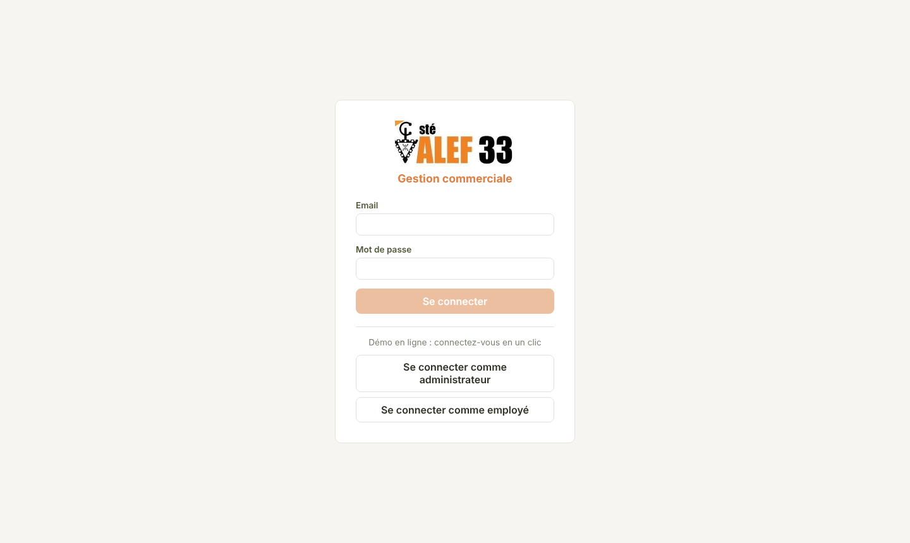
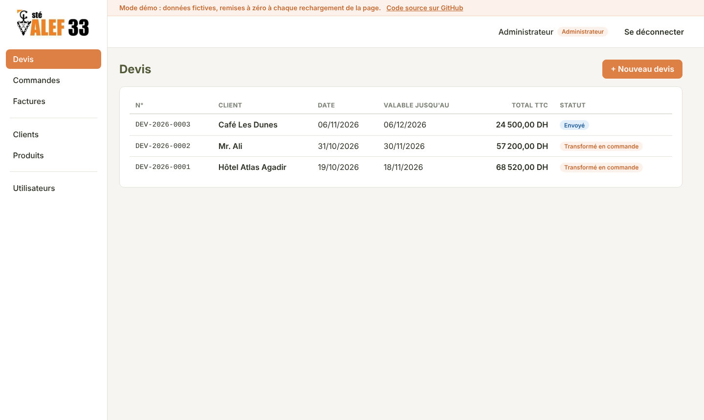
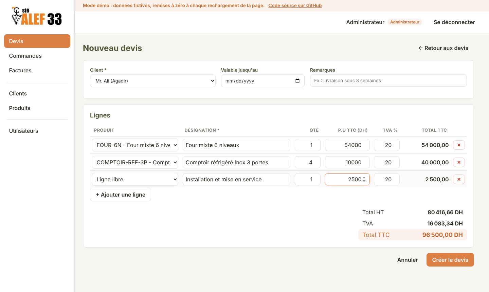
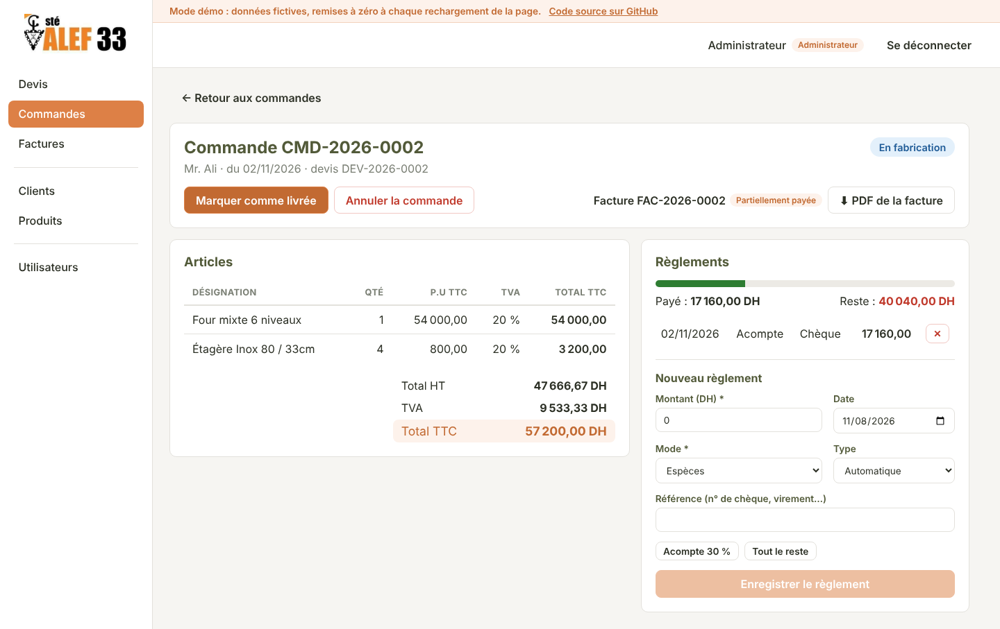
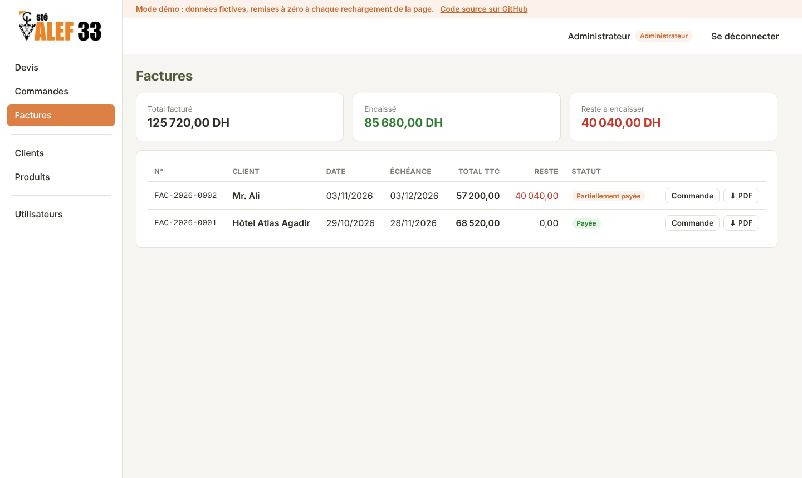
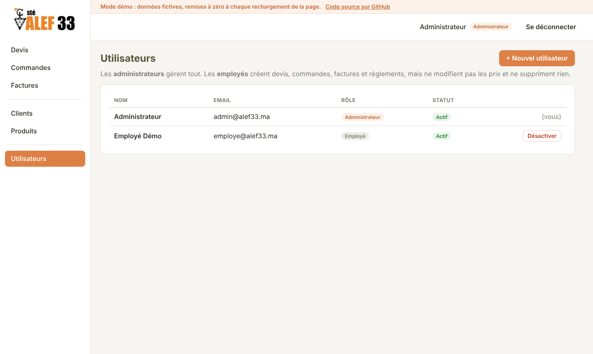
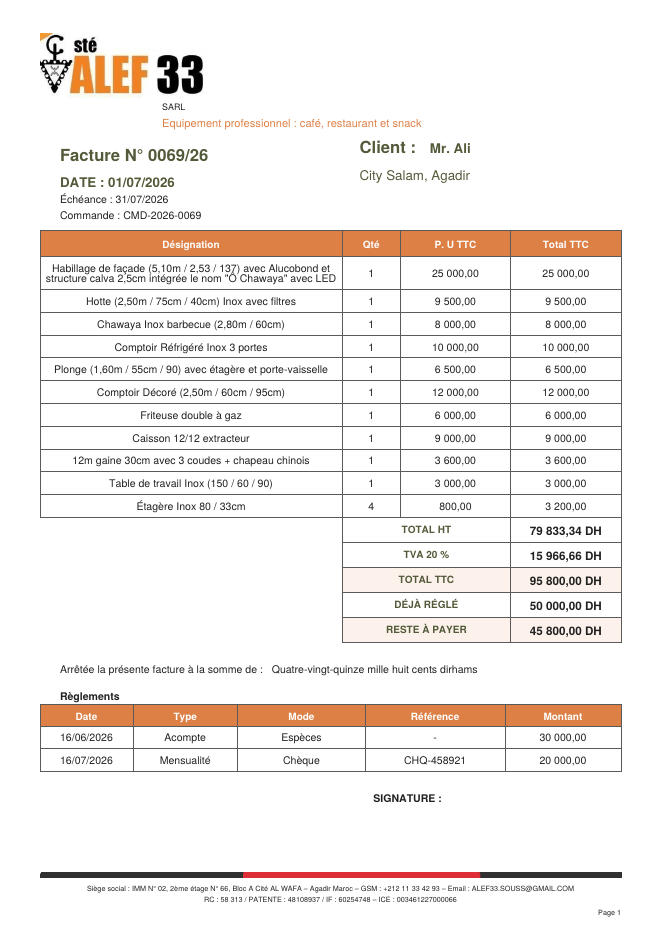
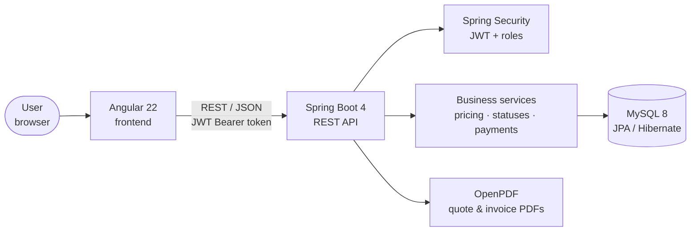
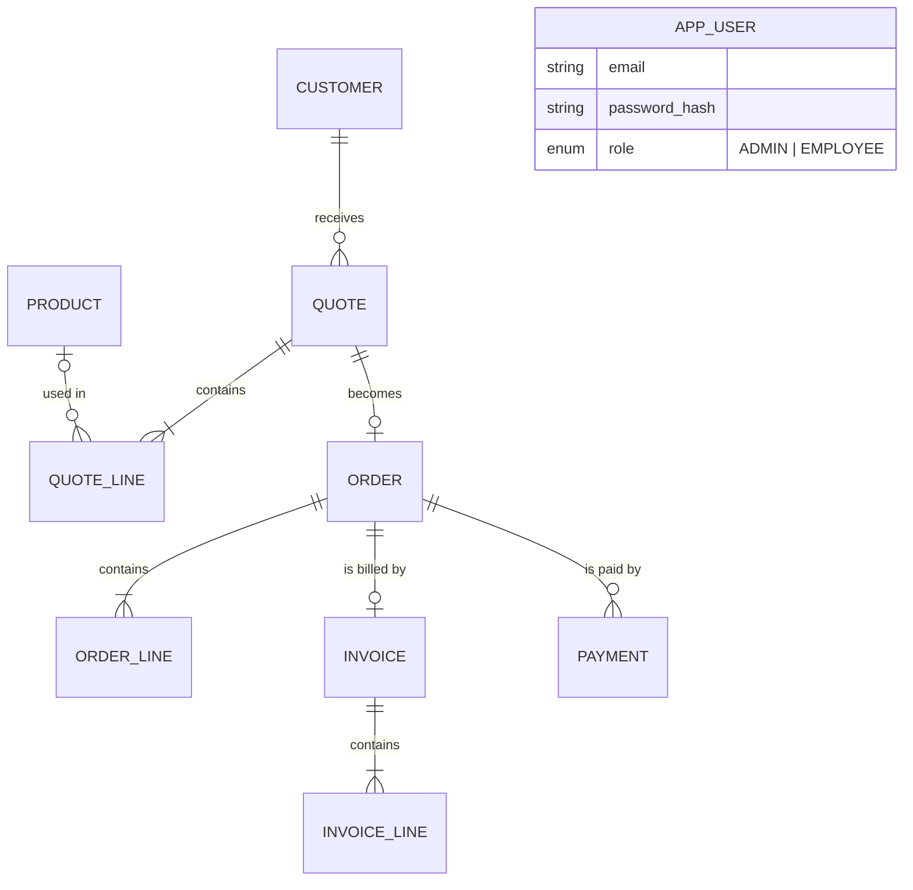

<div align="center">


# ALEF 33 — Quotes, Orders & Invoices

**Full-stack business application built for a real client: ALEF 33, a manufacturer of professional kitchen equipment in Agadir, Morocco.**

[](https://github.com/sanaa-code01/ALEF_33/actions/workflows/ci.yml)
[](https://github.com/sanaa-code01/ALEF_33/actions/workflows/pages.yml)


### 👉 [Live demo](https://sanaa-code01.github.io/ALEF_33/) — one-click login, no account needed

</div>

---

## Table of contents

1. [Context](#context)
2. [Features](#features)
3. [Screenshots](#screenshots)
4. [Architecture](#architecture)
5. [Tech stack](#tech-stack)
6. [Business rules](#business-rules)
7. [Data model](#data-model)
8. [Security](#security)
9. [REST API](#rest-api)
10. [Tests and CI/CD](#tests-and-cicd)
11. [Run the project](#run-the-project)
12. [About the live demo](#about-the-live-demo)
13. [Project structure](#project-structure)
14. [Author](#author)

---

## Context

ALEF 33 designs and manufactures stainless-steel equipment for cafés, restaurants and snack bars (ovens, refrigerated counters, hoods, work tables…). Their quotes and invoices were made by hand in Word, with no follow-up of orders or payments.

After gathering the requirements with the company, I built this application to digitize their whole sales process:

```
Quote  ──accepted──▶  Order  ──▶  Invoice  ──▶  Payments until fully paid
```

Two needs from the client shaped the design:

- **Prices are given TTC (VAT included).** The customer is promised a TTC amount, so the app calculates HT and VAT *from* the TTC price, and the total never shows a lost centime.
- **There is no fixed payment method.** Depending on the customer, ALEF 33 is paid in full, with a deposit then the balance at delivery, or in monthly installments. The app records any number of payments and always knows what is left to pay.

The PDFs reproduce ALEF 33's own document template (logo, layout, legal footer, amount written in French words).

---

## Features

| Area | What you can do |
|---|---|
| **Quotes** | Create a quote with product lines or free lines, live HT / VAT / TTC totals, send, accept or reject, download the PDF |
| **Orders** | Convert an accepted quote into an order, follow its status (pending → in production → delivered, or cancelled) |
| **Invoices** | Create the invoice of an order, download the PDF with payments and remaining amount, see billed / collected / outstanding totals |
| **Payments** | Record deposits, installments and balances (cash, cheque, transfer, card, bill of exchange), with paid / remaining and a progress bar |
| **Customers** | Search, create, edit (with ICE number); a customer with quotes cannot be deleted |
| **Products** | Catalog with TTC price and calculated HT; products are deactivated, never deleted, so old documents stay intact |
| **Users** | Admin page to create employee or admin accounts, and disable them |
| **PDF documents** | Quotes and invoices in ALEF 33's template, with the total written in words (*« Quatre-vingt-quinze mille huit cents dirhams »*) |

The interface is in French, for ALEF 33's team.

---

## Screenshots

| Login | Quotes |
|---|---|
|  |  |

| New quote with live totals | Order with payments |
|---|---|
|  |  |

| Invoices | User accounts (admin) |
|---|---|
|  |  |

**Generated invoice (PDF)**



---

## Architecture



The backend follows a classic layered design:

```
controller  →  service  →  repository  →  MySQL
   (REST)     (business      (Spring
               rules)        Data JPA)
```

- **Controllers** only receive and return **DTOs** (Java records), never JPA entities.
- **Services** hold every business rule and are covered by unit tests.
- A **global exception handler** turns errors into clear JSON answers (`ProblemDetail`) with French messages: 400 (invalid data), 401, 403, 404, 409 (business rule broken).

---

## Tech stack

| Layer | Technologies |
|---|---|
| **Backend** | Java 21, Spring Boot 4.1, Spring Web, Spring Data JPA / Hibernate, Bean Validation, Lombok |
| **Security** | Spring Security, OAuth2 Resource Server (JWT, HS256), BCrypt |
| **Database** | MySQL 8 |
| **PDF** | OpenPDF |
| **API documentation** | springdoc-openapi (Swagger UI) |
| **Frontend** | Angular 22 (standalone components, signals, zoneless), Reactive Forms, functional interceptors and guards |
| **Tests** | JUnit 5, Mockito, AssertJ |
| **DevOps** | Docker (multi-stage build), docker-compose, GitHub Actions (CI + GitHub Pages deployment) |

---

## Business rules

**Pricing (TTC first).** For each line:

```
line TTC = unit price TTC × quantity          (exact)
line HT  = line TTC ÷ (1 + VAT rate / 100)    (rounded to 2 decimals)
line VAT = line TTC − line HT                 (absorbs the rounding)
```

Example from a real ALEF 33 quote: 4 shelves at 800 DH TTC give exactly **3 200,00 DH**, not 3 200,02.

**Quote statuses**

```
DRAFT ──▶ SENT ──▶ ACCEPTED ──▶ CONVERTED (into an order)
   └────────┴────▶ REJECTED
```

- Only an **accepted** quote can be converted, and only **once**.
- An **expired** quote cannot be accepted.

**Order statuses:** `PENDING → IN_PRODUCTION → DELIVERED`, or `CANCELLED` before delivery. A delivered order is final.

**Invoices and payments**

- One invoice per order; a cancelled order cannot be invoiced.
- A payment must be positive and **cannot exceed the remaining amount**.
- Payments made **before** the invoice (a deposit at order) are counted when the invoice is created.
- The invoice status updates itself: `UNPAID → PARTIALLY_PAID → PAID`.
- The payment type is guessed when not given: first partial payment = deposit, last one = balance, all at once = full payment.

**Numbering:** `DEV-2026-0001`, `CMD-2026-0001`, `FAC-2026-0001`, restarting every year. PDFs show ALEF 33's format (`0001/26`).

---

## Data model



- Quotes, orders and invoices share a common base (`SalesDocument`: number, customer, HT / VAT / TTC totals).
- Each document **copies** its lines instead of sharing them: if a product price changes later, old invoices keep their original price.
- Orders are stored in the `orders` table but the entity is `CustomerOrder`, because `ORDER` is a reserved SQL word.

---

## Security

- **Stateless JWT authentication**: `POST /api/auth/login` returns a signed token (HS256, 8 h), sent as `Authorization: Bearer …`.
- Passwords are hashed with **BCrypt**; the API never returns them.
- **Role-based access control**:

| Action | ADMIN | EMPLOYEE |
|---|---|---|
| Read everything | ✅ | ✅ |
| Create quotes, orders, invoices, payments, customers | ✅ | ✅ |
| Create or change products and prices | ✅ | ❌ 403 |
| Delete anything | ✅ | ❌ 403 |
| Manage user accounts | ✅ | ❌ 403 |

- Secrets (JWT key, admin password, database credentials) come from **environment variables**, never from the code. `.env` is ignored by Git; `.env.example` shows the expected variables.
- CORS is limited to the frontend's origin.

---

## REST API

Full interactive documentation: **Swagger UI** at `http://localhost:8080/swagger-ui.html` when the backend runs.

| Resource | Endpoints |
|---|---|
| Auth | `POST /api/auth/login` · `GET /api/auth/me` |
| Customers | `GET/POST /api/customers` · `GET/PUT/DELETE /api/customers/{id}` |
| Products | `GET/POST /api/products` · `GET/PUT/DELETE /api/products/{id}` |
| Quotes | `GET/POST /api/quotes` · `GET /api/quotes/{id}` · `POST /api/quotes/{id}/send \| accept \| reject \| convert` · `GET /api/quotes/{id}/pdf` |
| Orders | `GET /api/orders` · `GET /api/orders/{id}` · `PATCH /api/orders/{id}/status` · `POST /api/orders/{id}/invoice` |
| Payments | `GET/POST /api/orders/{id}/payments` · `GET /api/orders/{id}/payment-summary` · `DELETE /api/payments/{id}` |
| Invoices | `GET /api/invoices` · `GET /api/invoices/{id}` · `GET /api/invoices/{id}/pdf` |
| Users (admin) | `GET/POST /api/users` · `PATCH /api/users/{id}/enabled` |

---

## Tests and CI/CD

**31 unit tests** (JUnit 5 + Mockito) cover the business rules, plus a Spring context test:

| Test class | What it checks |
|---|---|
| `PricingServiceTest` | TTC → HT → VAT, the 4 × 800 DH case, a real 11-line quote = exactly 95 800,00 DH, mixed VAT rates |
| `QuoteServiceTest` | product defaults, accept / reject / expiry rules, conversion only once |
| `OrderServiceTest` | status transitions, one invoice per order |
| `PaymentServiceTest` | deposit / balance / full detection, overpayment refused, invoice becomes PAID |
| `AmountInWordsTest` | French amounts in words (*quatre-vingts*, *soixante et onze*, *un million de*…) |
| `DocumentNumberServiceTest` | yearly numbering |

**GitHub Actions** runs on every push:

- **CI** (`ci.yml`): starts a MySQL service, compiles the backend and runs all tests, then builds the Docker image and validates `docker-compose.yml`.
- **Demo** (`pages.yml`): builds the Angular app and publishes the live demo on GitHub Pages.

---

## Run the project

### Option 1: everything with Docker (recommended)

Requirements: Docker Desktop.

```bash
git clone https://github.com/sanaa-code01/ALEF_33.git
cd ALEF_33
cp .env.example .env          # then change the passwords and the JWT secret
docker compose up --build -d
```

- API: http://localhost:8080 (Swagger: http://localhost:8080/swagger-ui.html)
- MySQL: `localhost:3307`
- Demo data is created at the first start. Log in with `admin@alef33.ma` and the `ADMIN_PASSWORD` from your `.env`.

Then start the frontend (below) and open http://localhost:4200.

### Option 2: development mode

Requirements: Java 21, Node.js 22.22+ (or 24), MySQL 8.

```sql
-- in MySQL
CREATE DATABASE alef33 CHARACTER SET utf8mb4 COLLATE utf8mb4_unicode_ci;
CREATE USER 'alef33'@'localhost' IDENTIFIED BY 'alef33';
GRANT ALL PRIVILEGES ON alef33.* TO 'alef33'@'localhost';
```

```bash
# backend (port 8080)
cd backend
./mvnw spring-boot:run

# frontend (port 4200), in another terminal
cd frontend
npm install
npx ng serve
```

Demo accounts in development: `admin@alef33.ma` / `Admin@2026` and `employe@alef33.ma` / `Employe@2026`.

### Run the tests

```bash
cd backend
./mvnw test
```

---

## About the live demo

The [live demo](https://sanaa-code01.github.io/ALEF_33/) is hosted for free on **GitHub Pages**, which only serves static files. To make it fully interactive anyway, the Angular app runs there in **demo mode**: an HTTP interceptor answers the `/api` calls inside the browser, with the **same business rules** as the Spring Boot services and demo data.

- Everything can be tried: quotes with live totals, conversion, payments, invoices, admin vs employee rights.
- Data is reset when the page is refreshed.
- PDF buttons download real documents generated by the backend.

The complete application (Spring Boot + MySQL + JWT + PDF generation) runs with `docker compose up` as described above.

---

## Project structure

```
ALEF_33/
├── backend/                         Spring Boot API
│   ├── src/main/java/com/alef33/
│   │   ├── config/                  OpenAPI, demo data, first admin account
│   │   ├── controller/              REST controllers
│   │   ├── dto/                     request / response records
│   │   ├── exception/               business exceptions + global handler
│   │   ├── model/                   JPA entities and enums
│   │   ├── pdf/                     PDF rendering, amount in words
│   │   ├── repository/              Spring Data JPA repositories
│   │   ├── security/                Spring Security + JWT
│   │   └── service/                 business logic
│   ├── src/test/java/…              unit tests
│   └── Dockerfile                   multi-stage build
├── frontend/                        Angular app
│   └── src/app/
│       ├── core/                    models, API services, auth, interceptor, guards
│       ├── features/                pages: quotes, orders, invoices, customers, products, users
│       ├── layout/                  sidebar + top bar
│       ├── shared/                  pipes, labels, toasts
│       └── demo/                    demo mode for GitHub Pages
├── docker-compose.yml               backend + MySQL
├── .env.example                     environment variables to fill in
└── .github/workflows/               CI and demo deployment
```

---

## Author

**Sanaa Daoud** — Software Engineering student at ENSA Agadir (Ibn Zohr University)

- GitHub: [@sanaa-code01](https://github.com/sanaa-code01)

Designed and built for **ALEF 33 SARL** (Agadir), from requirements gathering with the client to delivery.
